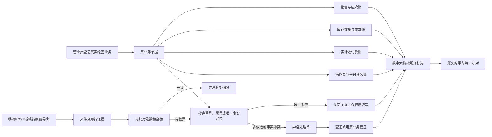
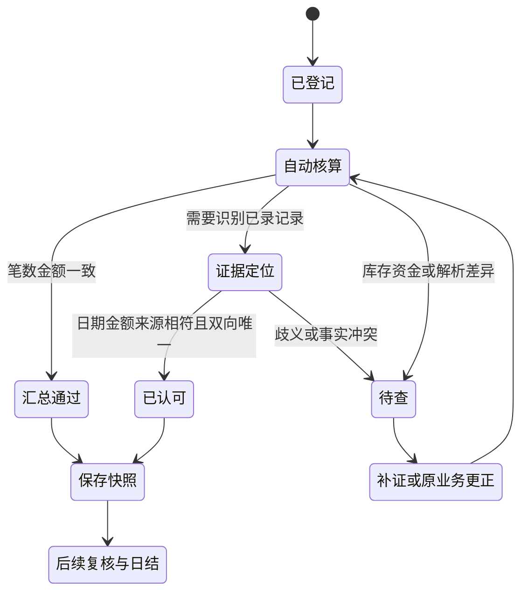

# 聚友通信账务模型总览

版本：2026-10-22.2。适用：店内财务、库存、销售及移动业务账务。

这套模型把“业务如何发生、账怎样计算、凭什么认可、异常怎样处理”连在一起，供数字大脑和现有进销存共同使用。机器定义见 [store-accounting-model.json](../tools/production-stage-20261022/server/src/store-accounting-model.json)，详细字段见 [数据模型](./门店账务数据模型-20261022.md)，验收见 [规则与验收](./门店账务规则与验收-20261022.md)。

## 1. 模型范围与实现状态

| 模型 | 负责回答 | 本次成果 |
| --- | --- | --- |
| 业务模型 | 什么经营活动，涉及谁，产生哪些原单 | 销售、采购、退货、库存、收付、移动业务及日结关系 |
| 数据模型 | 每种事实存在哪里，怎样关联 | 27类实体及现有集合映射、主键、关联和新增字段 |
| 账务模型 | 销售、货物、资金、往来各如何变化 | 事件与账务影响表、数量金额守恒及原处理器映射 |
| 规则模型 | 条件满足后做什么 | 21条编号规则，记录适用范围和实现状态 |
| 凭证与证据模型 | 哪个来源证明哪项事实 | 原文件、原行、原填写、来源声明和认可关联 |
| 对账与身份匹配模型 | 是不是同一笔，是否已有记录 | 汇总优先；完整号、尾号、唯一事实匹配参考实现 |
| 处理流程模型 | 下一步由谁办理 | 登记、核算、认可、差异、复核、锁账状态机 |
| 职责与权限模型 | 谁能查询、办理和确认 | 营业员、持有人、复核人、老板、数字大脑职责 |
| 异常与追溯模型 | 出错后怎样查清和纠正 | 歧义、重复、差额、失效证据、冲正与重试 |
| 指标与验收模型 | 什么条件算核对完成 | 8项核对指标、场景样例及可运行验收 |

**状态说明：**现有销售、库存、资金、供应商往来、每日扎账、信号机微信和流水汇总比对已有运行代码。本次新增的是完整模型定义和身份匹配参考实现。`statementEvidenceLinks`、统一 `accountingRuns`、自动认可写回和全流程编排属于模型定义的新增能力，需要完成对应接口和集成验证后才算上线。本文件不把模型定义当作功能已经上线。

## 2. 总体业务关系

数字大脑的工作对象是账务事实及其关联。销售开单、入库、退款和核销继续使用各自原处理器，数字大脑组织这些能力，记录办理身份、规则版本和来源依据。核心计算使用确定程序，大模型可帮助理解表达和解释结果。

## 3. 四本账分别核算，通过同一原单关联

| 账簿 | 核心内容 | 依据 | 不能混淆 |
| --- | --- | --- | --- |
| 销售账 | 成交额、退货冲减、销售成本、毛利、顾客应收 | 销售明细、退货明细、成本来源及调整 | 销售额与实际收款分别记录 |
| 库存账 | 每仓每SKU的数量、串号状态、库存价值及成本来源 | 入库、出库、调拨、退货、盘点及成本调整 | 已付款不证明货已收到；调拨不产生销售 |
| 资金账 | 实际收款、付款、资金位置、账户增减 | 收付款流水、实际到账证据、现金实点与交接 | 汇总核对不新增资金；转款与换现不重复记收入费用 |
| 往来账 | 应收、应付、预付款、退款及核销余额 | 业务约定、供应商结算、移动确认、国补确认 | 预计酬金、已确认应收、已到账分别列示 |

正式税务科目及完整借贷总账不在当前源码中。这套模型采用已有进销存业务账簿，不自行设置税率或把经营流水称作已完成法定财务报表。

## 4. 各业务事件对账务的影响

| 事件 | 销售/成本 | 库存 | 资金 | 往来与闭合 |
| --- | --- | --- | --- | --- |
| 销售开单 | 记录原成交和本单成本 | 实物按原出库规则减少 | 只记录原流程中真实发生的收款 | 未收部分继续保留应收或收款安排 |
| 订货 | 尚未形成销售或费用 | 尚未到货不加库存 | 有真实预付才记付款 | 预付关联指定订货单 |
| 实际验收入库 | 增加库存价值 | 按实际数量和串号入库 | 入库动作不重复付款 | 已明确归属的预付款按原规则抵用，余款挂应付 |
| 供应商付款/核销 | 不直接改变销售毛利 | 不证明实物入库 | 实际付款记一次；纯抵扣不造收付 | 按主体、来源和可用额分配 |
| 销售退货 | 原销售和成本按原退货流程冲减 | 实物验收后入库 | 实际退款沿原收款关联 | 未收款撤单不算已退款 |
| 库存调拨 | 不确认销售收入 | 源仓减、目标仓增，数量成本守恒 | 不自动产生收付款 | 保留调拨单和来源串号链 |
| 空充平台充值 | 实付、手续费、平台增额分列 | 不形成实物库存 | 记录真实转出 | 例如2000实付、1996增额，差4元单列核实 |
| 顾客现金充值 | 业务金额与收益口径分开 | 空充平台余额减少 | 门店真实收到现金 | 顾客实收与BOSS扣减按现行原单规则核对 |
| 移动酬金/国补 | 不把预计额当作实收 | 无实物变动 | 到账证据支持实际收款 | 预计、确认、到账分别跟踪 |
| 信号机微信换现30元 | 作为同笔换现识别 | 无实物变动 | 沿用已有现金+30和微信−30两张原单 | 只追加换现关联；无新增现金转存 |
| 外部文件比对 | 不自动改变原销售价或成本 | 不自动调整实物 | 汇总及认可均不新增第二条资金流水 | 真实原行唯一对应已有记录时可认可证据关联 |

## 5. 老板本次确认的经营规则

1. 门店普通付款单只能选择**现金库**或启用的**信号机微信**具体账户。老板给营业员发红包通过专用发放流程，使用**老板本人微信**；关联核定红包原单，仅记一次支出和营业员红包收入，不扣信号机微信。该例外不能通过普通付款请求启用。
2. 信号机微信由营业员实际使用，老板无法操作这个钱包；独立记录增加、减少和结余，与聚合支付和老板本人微信分开，每天由营业员核对。登记持有人不等于实际可操作人，不能因ownerId相同而混用账户。
3. 当前30元换现沿用已存在的两张收付款原单，通过关联闭合。
4. 会话中提供的280.13元是观察值；首次扎账提交当时实看余额后，才成为后续余额核对起点。
5. 移动流水和银行流水先核对同一期间的**笔数和金额合计**。两项一致即汇总通过，有差异再查明细。
6. 营业员原填写可以是完整号、尾号或有笔误。以原始外部流水为核对依据，日期、金额、业务范围及必要资金方向能正反向唯一对应时认可，并保留原填写。
7. 同尾号对应多个不同完整号时不得直接合并；一个内部记录被多条外部原行争用时也列待查。
8. 核算、导入、汇总、规则匹配和历史查询应在没有大模型时继续工作。

## 6. 真正的“认可”分层记录

| 认可层级 | 通过条件 | 保存结果 | 不据此推定的其他事实 |
| --- | --- | --- | --- |
| 汇总一致 | 同一筛选口径，笔数金额都相同，解析无错误 | 本次汇总核对通过 | 未逐笔证明每一笔都是同一来源 |
| 真实流水对应认可 | 真实外部原行对有效内部原单唯一，日期金额等事实相符 | 证据认可关联，明确完整号/尾号/唯一事实的定位方法 | 不把营业员原填写覆盖成从未出错 |
| 资金已核实 | 原流程所需真实到账证据或持有人核实已满足 | 资金核实状态及来源 | 银行流水不能替代现金实点或货物验收 |
| 业务或日结闭合 | 对该业务必要的库存、应收应付、实收实付及复核环节完成 | 业务状态或锁账快照 | 不把仍有争议的差额自动抹去 |

汇总通过和识别已有记录是两个并行结果：已有记录仍参加原文件笔数和金额汇总，不能为了避免重复记账而从原始总数中减掉。

## 7. 数字大脑的处理顺序

1. 识别本次业务、门店、办理人和必要权限，读取现行规则版本。
2. 查询当前真实业务单据、库存流水、资金流水及外部证据；按原业务日期计算。
3. 执行来源完整、金额精度、重复请求、原单有效和库存守恒校验。
4. 对移动与银行导出先做汇总；汇总有差异时展开明细。需要区分已录数据时执行身份识别，并分别展示其结果。
5. 唯一明确的事实形成认可关联；多候选、金额冲突、日期缺失、红冲和锁账变化列为具体异常。
6. 需要实际改账时，委托有权限的原业务处理器执行，保留事务、幂等、业务版本和操作记录。
7. 重新核算并保存处理批次、规则版本、原文件哈希、原行号和结果快照，供日结和追查使用。

## 8. 状态与职责

营业员登记事实、清点现金并查看信号机微信余额；实际持有人办理其账户收付；复核人核对他人扎账；老板处理例外和锁账签认。数字大脑以系统办理身份计算和识别，保存委托人和规则版本。角色权限继续采用现有服务端代码，不因助理理解了一句话就新增权限。

## 9. 规则版本与追溯

每次认可和改账至少记录：`tenantId`、`branchId`、原业务集合及ID、业务版本/事实指纹、外部原文件哈希及原行号、原填写、实际识别值、规则ID及版本、结果、办理身份和时间。

原单金额、日期、账户或红冲状态变化后，旧证据关联必须重新验证；更正追加记录。历史扎账使用提交时快照，不把今天的库存或余额回填成历史事实。

## 10. 落地边界

现有程序继续提供原业务的记账能力。本次模型给新增的数字大脑编排、证据认可写回和自动账务核对提供一致的数据契约。先对隔离数据完成验收，再将新增能力接入业务接口；每个动作都要能说明用了哪条规则、处理了哪张单、产生了什么账务变化。
