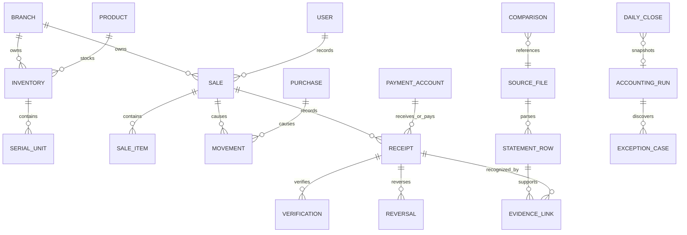

# 门店账务数据模型与数据字典

版本：2026-10-22.2。上层业务模型见 [业务总览](./门店账务业务模型-20261022.md)。

## 1. 复用当前存储结构

线上当前使用PostgreSQL。多数业务实体放在通用JSON记录表，串号、文件和身份使用专门表；本模型中的“实体”不等于必须新建一张物理表。

| 物理表 | 作用与主键 |
| --- | --- |
| `erp_tenants`、`erp_branches` | 账套和门店；门店通过`tenant_id,id`唯一 |
| `erp_records` | 门店业务集合；`tenant_id,branch_id,collection,record_key`唯一，`data`保存JSON |
| `erp_shared_records` | 账套共享的员工、知识等；`tenant_id,collection,record_key`唯一 |
| `erp_metadata` | 门店元数据；`tenant_id,branch_id,key`唯一 |
| `erp_serial_units` | 串号实物；`tenant_id,serial_no`唯一，同时保存门店和库存键 |
| `erp_files` | 原文件；`tenant_id,sha256`唯一，`content`为原二进制 |
| `erp_sessions`、`erp_credentials` | 会话和登录凭据；不纳入数字大脑业务知识正文 |
| `erp_outbox` | 事务提交后的通知/事件投递状态 |

依据：`server/migrations/postgres/002_store_runtime.sql`及`server/src/capacity/postgres.js`。本次模型不迁移或覆盖这些表中的历史记录。

## 2. 所有实体的共同字段

| 字段 | 类型/含义 | 约束 |
| --- | --- | --- |
| `tenantId` | 账套标识 | 作用域来自会话和服务端上下文，不能信任客户端自行指定 |
| `branchId` | 门店标识 | 门店业务不能跨门店推定同一笔；共享实体按现有共享规则处理 |
| `id` | 稳定内部ID | 不使用名称或流水尾号充当主键 |
| `displayNo` | 可读业务单号 | 可以查询展示；关联仍使用内部ID |
| `businessDate` / 原业务日期字段 | 北京时间经营日 | 区分实际发生、录入时间、银行入账日和平台业务日 |
| `createdAt` | 带时区的录入时间 | 历史补录不能冒充今天实际发生 |
| `operatorId` / `createdBy` | 实际登记人 | 原登记人和系统认可人分开 |
| `version` / `factsFingerprint` | 版本或事实摘要 | 写入前校验，防止用旧预览确认变化后的账务 |
| `events` | 追加式处理轨迹 | 原值、更正值、依据、办理身份和时间可追溯 |

现有集合字段命名并不完全一致。适配层负责读取，不将每个旧对象强制批量改名。

## 3. 核心实体关系



`STATEMENT_ROW`可以由原文件重新解析得到；`EVIDENCE_LINK`和统一`ACCOUNTING_RUN`是扩展实体。图中连线表达业务关系，不宣称所有关联已是数据库外键。

## 4. 主数据与原业务集合

| 实体 | 当前集合/来源 | 关键字段与关联 |
| --- | --- | --- |
| 员工 | `users`，账套共享 | `id,roleCode,status,permissions,branchIds` |
| 供应商/顾客/其他往来 | `suppliers,customers,fundParties` | 主体ID及类型；与账户持有人区分 |
| 收付款账户 | `paymentAccounts`及`cash-vault.account()` | `id,name,channel,ownerId,active`；现金库是系统账户。ownerId是登记持有人，不能代替实际操作权限；老板本人微信与营业员使用的信号机微信分别核算 |
| 商品SKU | `products` | `skuId,name,warehouseId,stockManaged,trackSerial` |
| 库存 | `inventory` | 库存键=`warehouseId/skuId`；`quantity,stockValue,costPrice,costSources,costingMethod` |
| 串号实物 | `erp_serial_units` / `inventory.serials` | `serial_no,status,purchaseId,purchaseItemId,originSkuId`；完整串号唯一 |
| 库存变动 | `movements,stockTransfers` | `id,sourceId,skuId,warehouseId,quantity,cost`；出入库按符号记量 |
| 销售 | `sales`及`items` | `id,items,amount,paymentParts,receivedAmount,pendingAmount`；一单可多明细多笔收款 |
| 订货/入库 | `procurementPlans,purchases`及`items` | 订货、实际收货与付款分层关联 |
| 退货/更正 | `saleReturnRequests,saleReturns,purchaseReturnRequests,purchaseReturns,costAdjustments` | 原单ID、原明细、实物、金额及成本影响分别保留 |
| 收款/付款原单 | `otherIncome,expenses,supplierCash,paymentRequests` | `amount,date,reference,paymentParts,operatorId`；请求付款不等于实际付款 |
| 资金流水 | `receipts` | `sourceId,partId,kind,amount,paymentAccountId,accountOwnerId,reference,transactionDate` |
| 核实与复核 | `moneyVerifications,businessReconciliations` | `receiptId/sourceId,version,status,verifiedAmount,events` |
| 供应商往来 | `supplierEntries,supplierSettlements,supplierCash` | 应付、预付、应退和抵货额度分别计算；核销引用双方来源 |
| 移动业务 | `carrierServices,cardBusinesses` | `externalOrderNo,serviceDate,transactionAmount,employeeId` |
| 分月酬金及到账 | `carrierServices.schedule.events` | 预计、确认和到账；实际到账`bankRef`与平台业务号属于不同命名空间 |
| 空充平台 | `airRechargeEvents,airFundingOrders` | `businessDate,amount,paidAmount,cashReceived,reference,bankRef,serialType,serialTail5,platformRef` |
| 换现关联 | `walletCashExchanges` | `cashReceiptId,walletReceiptId,paymentAccountId,amount`；不新增资金流水 |
| 日结 | `dailyCloseouts` | `date,snapshot,manual,cashierId,reviewerId,actualCash,walletActualBalance,status` |
| 外部汇总比对 | `statementComparisons` | 两份原文件元数据、映射、期间、金额口径、笔数、金额、差额及结果 |

仓库使用当前目录：A仓手机数码、B仓配件维修、C仓移动业务、其他仓。C仓内商品仍按真实商品和库存规则管理；服务项目由`stockManaged=false`表达。

## 5. 金额、数量与成本类型

新模型的`amountCents`、`valueCents`、`differenceCents`均为**整数分**。原`amount=30.00`在适配时变为`amountCents=3000`，写回仍使用原处理器要求的单位。

- 资金原流水按现有符号：收款为正，付款为负。
- 汇总比对可选择绝对金额或保留正负号，选项属于结果快照，重查时必须沿用。
- 汇总的绝对金额口径不意味着真实资金方向可以忽略。逐笔资金证据认可仍要核对收付方向。
- 数量、件数和可售串号数采用整数；服务数量按现有商品和原处理器校验。
- 成本按该库存现行`costingMethod`及成本来源执行。源码已有`fifo-v1`分支，旧库存还可能使用既有成本来源方式，模型不把旧说明中的平均成本或FIFO当作全部库存统一事实。

## 6. 外部流水原行 `StatementRow`

建议契约：

```json
{
  "id": "sha256:工作表:原行号",
  "domain": "bank",
  "sourceSha256": "原始二进制文件的SHA-256",
  "sheet": "交易明细",
  "row": 12,
  "date": "2026-10-22",
  "amountCents": -3000,
  "direction": "out",
  "reference": "202610220000012345",
  "referenceType": "full",
  "note": "经营付款"
}
```

| 字段 | 约束 |
| --- | --- |
| `id` | 由来源文件哈希、工作表、原行号确定；不能以金额或尾号做ID |
| `domain` | 例如`bank`、`mobile_business`、`mobile_air`；跨来源域不自动配对 |
| `reference` | 保留完整字符串、前导零、原始长度，不转为浮点数 |
| `referenceType` | `full/suffix/auto/unknown`；明确尾号与完整号分开 |
| `date` | 由选定日期列及来源定义；日期无法识别不能当作今天 |
| `amountCents` | 精确到分；空值、错误字符和超精度必须提示原行 |
| `direction` | 资金原行的实际收付方向；平台扣减与现金收款需要各自明确语义 |
| `sourceSha256,sheet,row` | 能重新打开相同的原文件和原行 |

来源文件还应记录`sourceKind`、`uploadedBy`、`uploadedAt`、`declaredAccountId`及`provenanceStatus`。用户提供的银行导出属于`user_provided_export`；文件哈希证明上传后的内容一致性，不表示系统完成银行直连验真。

同一文件可有多个工作表或多个期间。选择的工作表、表头行、日期列、金额列、收入/支出列和筛选条件必须一并保存。

## 7. 已录流水的编号身份 `ReferenceIdentity`

```json
{
  "originalValue": "00012",
  "normalizedValue": "00012",
  "kind": "suffix",
  "precision": 5,
  "namespace": "mobile_air",
  "sourceCollection": "airRechargeEvents",
  "sourceId": "原业务内部ID"
}
```

现有历史空充支持`serialType=tail5`、`serialTail5`及`TAIL5:日期:类型:尾号`。适配时保留这个历史结构，抽取真正尾号后识别；不能把整个`TAIL5:...`文本当作外部完整流水号。

兼容营业员直接填写尾号、`尾5位00012`或掩码编号。参考实现对自动识别采用短数字启发式，显式`referenceType`优先；集成时应从已有`serialType`字段读取精度，不能把所有短编号都永久认定为尾号。

完整号不同的两条外部流水，即使尾号相同，也是两个独立原行。是否认可某个内部记录，由日期、金额、业务域及双向唯一性共同决定。

## 8. 证据认可关联 `EvidenceLink`（新增契约）

| 字段 | 含义/限制 |
| --- | --- |
| `id,evidenceKey` | 关联ID及幂等键 |
| `statementComparisonId` | 来源比对批次 |
| `sourceSha256,sheet,row` | 外部证据原行 |
| `sourceCollection,sourceId,receiptId` | 被认可的内部原单；移动业务对应业务ID，资金对应已有receiptId |
| `originalReference,externalReference` | 同时保留营业员原填写和外部真实编号 |
| `matchMethod` | `full/suffix/unique_facts` |
| `factsFingerprint` | 接受时内部原事实摘要，供后续变化检测 |
| `decision` | `recognized/pending/revoked` |
| `ruleId,ruleVersion` | 明确使用R09—R13中的规则及版本 |
| `acceptedBy,acceptedActorType` | 系统或人类办理身份，不能借用营业员身份 |
| `acceptedAt,revokedAt,revocationReason` | 建立、失效和原因 |

自动认可要求一个外部原行和一个内部候选双向唯一。需要合并收款、分笔结算、手续费或跨日到账时，保留组合对象，走明确的组合规则或人工核对，不能随便拆补金额凑平。

同一个`receiptId`可以有多个独立证据来源，但同一来源原行不能重复增加资金。证据认可不是一张新的收付款单。

## 9. 数字大脑执行契约

### 核对批次 `AccountingRun`

保存`id,date,modelVersion,ruleVersions,sourceFingerprint,salesSummary,inventorySummary,financeSummary,statementSummary,checks,exceptions,createdAt`。

`sourceFingerprint`覆盖本次真实参与计算的原业务、资金、库存与证据版本。相同输入重复运行可返回同一核对结果；不同输入产生新批次，历史批次保留。

### 办理命令 `ExecutionCommand`

保存`commandId,tenantId,branchId,requestedBy,executorType,action,sourceCollection,sourceId,expectedVersion,inputDigest,idempotencyKey,evidenceLinkIds,status,resultRefs,error`。

`action`必须属于受控的原业务动作白名单，例如核实既有收付款、原单退款、合法库存调拨、保存扎账。不把任意自然语言、模型文字或原文件中的指令直接当作可执行代码。

### 领域事件 `AccountingEvent`

保存`eventId,eventType,commandId,sourceRefs,occurredAt,recordedAt,ruleVersion,actor,beforeFingerprint,afterFingerprint`。例如`ExternalEvidenceRecognized`、`ReceiptVerificationChanged`、`InventoryTransferred`、`DailyCloseLocked`。

事件描述已经发生的事实；发出办理请求不能伪装为动作已完成。沿用当前事务及`erp_outbox`在提交后投递事件。

## 10. 异常与更正模型

异常单保存`id,ruleId,code,severity,sourceRefs,evidenceRefs,observedValue,expectedValue,difference,assigneeId,status,events`。

| 类型 | 典型原因 | 正确处理 |
| --- | --- | --- |
| 数据待修正 | 日期/金额无法识别、编号已失精度 | 显示原行，修正列映射或重新导出 |
| 歧义 | 同尾号、同日同额多笔，或多个外部原行争用一张内部单 | 列候选，不强行关联 |
| 金额或方向冲突 | 日期编号相似，但真实收付不一致 | 查原单、手续费、分笔、延迟到账等实际原因 |
| 重复 | 相同文件与条件重复上传，或重复业务请求 | 返回原结果；不增加资金或库存 |
| 证据失效 | 原单已红冲、金额或日期变化 | 撤销旧认可状态并重算 |
| 库存不守恒 | 串号数、数量、成本不一致 | 查出入库来源并走盘点/更正 |
| 锁账后变化 | 原账期已锁定 | 按现行解锁或原业务更正流程处理 |

## 11. 数据质量与责任约束

1. 不把缺失的期初、成本、账户或持有人默认补成零或老板。
2. 内部单号、业务平台号、银行流水号、商品串号采用不同命名空间。
3. 原文件总笔数和金额保留；识别“已经录入”不改变原文件统计。
4. 查账、导出和原文件下载采用同一权限检查；不能通过知道文件哈希绕过门店权限。
5. 数据保留`occurredAt`与`recordedAt`；补录、认可和更正分别记录时间。
6. 只有明确事实唯一对应时才能自动认可；用户最新“汇总优先”规则不被模型扩成“所有业务都必须逐笔人工审批”。

## 12. 与现有系统衔接

先在现有JSON集合内扩展证据和核对批次；需要性能优化时再建立查询投影或专门表。原始交易、旧余额和历史日结不因模型升级重新导入。

金额和库存的写入依旧落在原服务事务中。读模型、核对模型与执行命令分开，防止打开数字大脑页面就重复记账。
